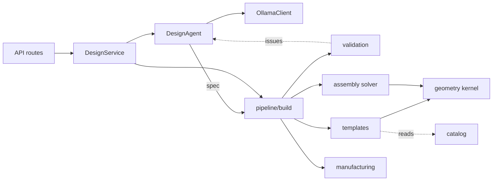

# PSR Print Studio: Backend

The backend turns a design request into printable, assembled 3D parts.
An LLM (or a person) writes a **DesignSpec** (JSON). The backend builds the parts from
templates, solves the joints, checks printability, collisions and stability, and exports
GLB meshes, STL build plates and a `manifest.json` for the web viewer.

## Architecture: three layers

| Layer | Responsibility | Packages |
|---|---|---|
| **1. API layer** | HTTP: requests, responses, status codes, file downloads | `api/` |
| **2. Application layer** | Use cases: build a design, run the AI loop, order the steps | `services/`, `ai/`, `pipeline/` |
| **3. Domain & engine layer** | The knowledge: parts, joints, checks, geometry, manufacturing | `core/`, `catalog/`, `templates/`, `assembly/`, `validation/`, `geometry/`, `manufacturing/` |

Rule: dependencies point **down only** (API → Application → Domain). The domain layer never
imports the API or the AI.

---

## 1. API layer (`api/`)

| Module | Purpose | Pattern |
|---|---|---|
| `app.py` | Creates the FastAPI app and mounts the router | - |
| `routes.py` | `/health`, `/catalog`, `POST /designs`, `POST /designs/from-prompt`, manifest / mesh / plate downloads | **Lazy singleton** (`@lru_cache` `DesignService`), **exception translation** (DesignError → 422, NeedsInput → 409, Ollama down → 503), path-traversal guard |
| `schemas.py` | Request / response models | **DTO** (Pydantic) |

## 2. Application layer

### `services/`
| Module | Purpose | Pattern |
|---|---|---|
| `design_service.py` | Single entry point: `build`, `check`, `design_from_prompt` | **Facade**: hides catalog, templates, kernel, pipeline and AI behind one class |

### `ai/`
| Module | Purpose | Pattern |
|---|---|---|
| `orchestrator.py` | `DesignAgent`: LLM writes a spec → build → failed checks go back to the LLM (max 3 rounds); `NeedsInput` when the LLM asks questions | **Feedback loop** with **dependency injection** (LLM and build function are passed in, so tests use a fake LLM) |
| `schema.py` | Generates the JSON schema the LLM must follow, from the catalog and templates | **Factory** (dynamic Pydantic models, discriminated union by template) |
| `prompt.py` | Builds the design and revision prompts; contains `EXAMPLE_SPEC` | - |
| `ollama_client.py` | Talks to the local Ollama server (temperature 0, structured output) | **Adapter** (wraps the Ollama client, converts its errors to `OllamaConnectionError`) |

### `pipeline/`
| Module | Purpose | Pattern |
|---|---|---|
| `build.py` | `validate_design` and `build_design`: spec check → build parts → solve joints → cut interfaces → checks → export | **Pipeline orchestration**, **two-pass build** for templates that need the assembly |
| `jobs.py` | Small background job queue for long builds | **Job queue** |

## 3. Domain & engine layer

### `core/`: shared data
| Module | Purpose | Pattern |
|---|---|---|
| `spec.py` | `DesignSpec`, `PartSpec`, `Connection`, `HardwareUse` | **DTO / data contract** between LLM, frontend and builder |
| `issues.py` | `Issue`, `DesignError`, `has_errors` | **Errors as data**: one format for API responses and LLM feedback |
| `frames.py` | 4×4 transforms (`rot_z`, `translate`, `FLIP`) | **Value objects** |
| `settings.py` | Settings from environment / `.env` | **Cached configuration object** |

### `catalog/`: real-world data (YAML in `catalogs/`)
| Module | Purpose | Pattern |
|---|---|---|
| `models.py` | `HardwareSpec`, `InterfaceSpec` (strict, unknown keys rejected) | **Schema validation** |
| `registry.py` | Loads and validates one YAML folder | **Generic registry** (`Registry[T]`), **data-driven design**: a new servo or printer is a YAML file, not code |
| `loader.py` | `Catalog` = hardware + interfaces + printers + materials | **Aggregate** + cached loading |

### `templates/`: part types
| Module | Purpose | Pattern |
|---|---|---|
| `base.py` | `Template`, `TemplateParams`, `BuildContext`, `BuiltPart`, `Body`, `Site`, `"auto"` values | **Template Method** (`parse → resolve → build`, `build` is abstract) |
| `registry.py` | `default_templates()`: name → template | **Registry**, **open/closed**: a new part type is a new class |
| `parts/*` | `enclosure`, `link`, `pedestal`, `sensor_mount`, `brick` | **Strategy** (one class per part type) |
| `features/*` | `shell`, `standoffs`, `cutouts`, `vents`, `interfaces` (pin/bore, screws, dovetail, studs) | **Composable features**; interfaces use a **dispatch table** by feature name |

### `assembly/`: how parts fit and move
| Module | Purpose | Pattern |
|---|---|---|
| `graph.py` | Connection tree checks: one base, no cycles, no loose parts | Graph validation |
| `solver.py` | `Joint`, `build_joints`, `solve`: world matrix of every part | **Forward kinematics** (BFS over the tree): `child = parent @ parent_frame @ Rz(angle) @ child_offset` |
| `collision.py` | Sweeps revolute joints; part–part and hardware–part overlaps | **Sampling sweep** (ends, rest pose, 5 steps) |
| `manifest.py` | Builds `manifest.json` for the viewer: parts, world matrices, joints, hardware, issues | **Serializer** (domain → frontend contract) |

### `validation/`: checks
| Module | Purpose | Pattern |
|---|---|---|
| `pipeline.py` | `Stage`, `run_stages`, `issues_for_ai` | **Pipeline / chain of stages** (cheap first, stop at first stage with errors) |
| `spec.py` | Pre-build: ids, templates, params, sites, interfaces, tree shape | **Fail fast** |
| `printability.py`, `geometry.py`, `hardware.py`, `physics.py` | Wall thickness and bed size; valid solids; hardware fit; centre of mass over the base | One check per module (**single responsibility**) |

### `geometry/`: CAD
| Module | Purpose | Pattern |
|---|---|---|
| `kernel.py` | `CadQueryKernel` (exact) and `PreviewKernel` (numpy, approximate); `set_kernel("auto")` | **Strategy + Adapter**, runtime selection with **fallback**, module-level singleton. The only module that touches CadQuery |
| `mesh.py` | `TriMesh`: bounds, normals, volume, transform | **Value object** |

### `manufacturing/`: from parts to printer
| Module | Purpose | Pattern |
|---|---|---|
| `profiles.py` | `PrinterSpec`, `MaterialSpec` (fit classes, bed, no-print zones) | Schema validation |
| `orientation.py` | Picks the face each body is printed on | **Heuristic scoring** |
| `packing.py` | Places parts on the bed around no-print zones | **Greedy shelf packing** |
| `plates.py` | `plan_plates`, `export_plate` | **Facade** over orientation, packing and export |
| `export.py` | Binary STL and GLB writers / reader (numpy only) | **Adapter** to file formats |

---

## How the layers work together

- **`DesignService` is the only door** into the engine. The API and the demo both call it.
- **`DesignSpec`** (core) is the contract. The AI produces it, `pipeline/build` consumes it.
- **`templates` and `validation` read the `catalog`**, so behaviour comes from data, not hardcoded values.
- **`Issue`** objects flow upward: validation → `DesignError` → the API (422) or back to the `DesignAgent` as LLM feedback.
- **The geometry `kernel`** is used by templates, the solver, collisions and export, but nothing else knows whether CadQuery or the preview kernel is running.
- **`manifest.json`** links the backend to the frontend: the viewer applies the same matrix rule as `solver.py`.

## Legacy (still in the repository)

`main.py`, `AssemblyPlan`, `PromptInterpreter`, `GenerationAgent`, `assembly_service`,
`build_plate_service`, `brick_collection_service` and `spatial_planner` belong to the earlier
brick-based system. `main.py` still runs it; the new system starts at `DesignService`.